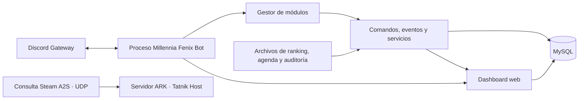

# Millennia Fenix Bot

<p align="center">
  <strong>El bot modular de Discord y la dashboard de administración de ArkMillennia Fenix.</strong><br>
  Comandos, servicios y páginas que crecen mediante módulos independientes.
</p>

<p align="center">
  <a href="https://nodejs.org/"></a>
  <a href="https://discord.js.org/"></a>
  
  
</p>

<p align="center">
  <a href="#millennia-fenix-bot">Resumen</a> ·
  <a href="#requisitos">Requisitos</a> ·
  <a href="#instalación-y-arranque">Instalación</a> ·
  <a href="#módulos-incluidos">Módulos</a> ·
  <a href="#módulos-de-la-dashboard">Dashboard</a> ·
  <a href="#contribuir">Contribuir</a>
</p>

Millennia Fenix Bot administra la comunidad de Discord de ArkMillennia Fenix y ofrece una dashboard web para configurar sus funciones. Incluye módulos para tienda, ranking, calendario, auditoría y consulta de estado ARK. La consulta de juego usa Steam A2S de solo lectura; el bot no controla el servidor.

Su arquitectura permite que cada módulo aporte comandos, eventos, servicios, rutas de API y páginas a la dashboard. Los módulos pueden evolucionar sin convertir el núcleo del bot en una colección de funciones acopladas.

> **Estado del proyecto:** en desarrollo activo. Las interfaces internas pueden cambiar mientras se consolidan los módulos y sus contratos.

## Contenido

- [Requisitos](#requisitos)
- [Instalación y arranque](#instalación-y-arranque)
- [Estructura del proyecto](#estructura-del-proyecto)
- [Módulos incluidos](#módulos-incluidos)
- [Cómo funcionan los módulos](#cómo-funcionan-los-módulos)
- [Módulos de la dashboard](#módulos-de-la-dashboard)
- [Datos y permisos](#datos-y-permisos)
- [Recargar módulos sin reiniciar el bot](#recargar-módulos-sin-reiniciar-el-bot)
- [Pruebas](#pruebas)
- [Contribuir](#contribuir)

## Arquitectura



El proceso de Discord y la dashboard comparten el mismo runtime y la misma carga de módulos. El bot puede iniciar aunque el servidor de ARK esté apagado o no responda a A2S. Los módulos de ranking, calendario y auditoría leen sus propios archivos de entrada bajo `data/ark/`; consulta los formatos y la configuración en [docs/ark-modules.md](docs/ark-modules.md).

## Requisitos

- Node.js 24.17 o posterior.
- Una base de datos MySQL accesible desde el host del bot.
- Una aplicación y un bot de Discord con los permisos e intents que necesiten los módulos habilitados.

## Instalación y arranque

1. Copia `.env.example` a `.env`.
2. Completa como mínimo `DISCORD_TOKEN`, `DISCORD_GUILD_ID`, `DASHBOARD_REQUIRED_ROLE_ID` y los datos `DB_*`.
3. Para el inicio de sesión de la dashboard, completa `DISCORD_OAUTH_CLIENT_ID`, `DISCORD_OAUTH_CLIENT_SECRET` y `DASHBOARD_PUBLIC_URL`.
4. Instala dependencias con `npm ci`.
5. Inicia el bot con `npm start`.

Configura en Discord Developer Portal la URL de retorno OAuth como:

```text
<DASHBOARD_PUBLIC_URL>/auth/discord/callback
```

En el Discord configurado, concede al bot los permisos de cada módulo. El gestor de rangos necesita **Manage Roles**, y el rol más alto del bot debe estar por encima de los rangos que manejará.

En Discord Developer Portal habilita **Server Members Intent** y **Message Content Intent**, que el proceso solicita al conectarse. Todas las funciones de Discord usan el único `DISCORD_GUILD_ID` configurado.

La dashboard escucha en `DASHBOARD_HOST` y `DASHBOARD_PORT`. `DASHBOARD_REQUIRED_ROLE_ID` es el rol obligatorio para iniciar sesión. Cada módulo puede aplicar permisos adicionales con su función `canAccess`.

Mantén `.env` en el host y fuera de Git. El bot crea sus tablas MySQL al iniciar. La configuración y los datos de módulos, las sesiones de la dashboard, los borradores y las imágenes de anuncios se guardan en MySQL. `data/` solo se usa para importar datos de versiones antiguas cuando corresponda.

## Estructura del proyecto

```text
index.js                         Entrada de npm start
bot/
  standalone.cjs                 Proceso independiente de Discord.js
  runtime/
    modules.cjs                  Carga, validación y ciclo de vida de módulos
    database.cjs                 MySQL y almacenamiento por módulo
  modules/                       Un archivo JavaScript por módulo
  dashboard/
    system.cjs                   Inicio de sesión y shell compartido
    public/                      Inicio, navegación, estilos e iconos comunes
  features/                      Lógica y páginas de cada función
    <modulo>/
      public/                    HTML, JavaScript y CSS propios del módulo
```

Por ejemplo, `bot/modules/rolemanager.js` registra el gestor de rangos y su lógica vive en `bot/features/rolemanager/`. Mantén estable el nombre del archivo del módulo: se usa como ID y como espacio de almacenamiento en MySQL.

### Módulos incluidos

| ID | Función |
| --- | --- |
| `anuncios` | Editor de anuncios por DM, consentimiento, imágenes e historial. |
| `logs` | Registro configurable de actividad y eventos de Discord. |
| `rolemanager` | Administración de rangos de usuarios en el Discord configurado. |
| `launcher` | Servicios de vinculación de cuentas de Discord y sesiones para un launcher. |
| `general` | Comandos básicos como `/ping`, `/estado` y `/saludo`. |
| `tienda` | Catálogo de criaturas y artículos, búsquedas privadas, kits y paquetes de puntos. |
| `ranking` | Panel de temporada y consultas privadas con ocho categorías y paginación. |
| `arkstatus` | Panel de disponibilidad y jugadores mediante consulta Steam A2S de solo lectura. |
| `modosark` | Calendario PvP/PvE y publicación de cambios de modalidad desde un archivo de agenda. |
| `auditoriaark` | Entrega privada y sin duplicados de eventos administrativos JSON del clúster. |

La configuración, los datos y los requisitos de cada módulo ARK están en [docs/ark-modules.md](docs/ark-modules.md). Los módulos no leen contraseñas RCON ni ejecutan comandos de juego.

## Cómo funcionan los módulos

Al iniciar, el gestor busca archivos `.js` y `.cjs` en `bot/modules/`, valida los comandos y carga cada módulo. El nombre del archivo es su ID: `rolemanager.js` corresponde al ID `rolemanager`.

Un módulo puede exportar:

- `version`: versión informativa del módulo.
- `commands`: comandos de Discord registrados por el bot.
- `setup(context)`: preparación de servicios, páginas, eventos y tareas.
- `activate(context)`: trabajo que debe comenzar cuando el módulo ya está activo.
- `dispose(context)`: limpieza al descargar o reemplazar el módulo.

`setup` tiene un máximo de 10 segundos. El gestor valida nombres duplicados o reservados y no activa una versión nueva si falla su preparación. Al descargar o recargar un módulo, libera sus eventos, intervalos y servicios registrados.

El objeto `context` proporciona:

- `client`: cliente de Discord.js.
- `guildId`, `dashboardRoleId` y `adminRoleIds`: IDs de servidores y roles configurados.
- `storage`: almacenamiento MySQL separado por módulo. Incluye `get`, `set`, `setIfAbsent`, `delete`, `entries` y métodos para blobs.
- `provide(nombre, servicio)`: publica un servicio durante `setup` para que otros módulos puedan usarlo.
- `services.get(nombre)`: obtiene servicios activos, incluidos los del sistema como `system:dashboard` y `system:bot`.
- `on(evento, handler)`: registra eventos de Discord. El contexto se añade como último argumento del handler.
- `every(milisegundos, handler)`: programa una tarea; el intervalo permitido es de 100 ms a 24 horas.
- `run(tarea)`: ejecuta una tarea dentro del ciclo de vida protegido del módulo.
- `onClose(handler)`: registra una función de limpieza.
- `log(mensaje)`: escribe una línea identificada con el ID del módulo.

Ejemplo mínimo de un módulo con comando:

```js
const { SlashCommandBuilder, MessageFlags } = require('discord.js');

module.exports = {
  version: '1.0.0',
  commands: [
    {
      data: new SlashCommandBuilder()
        .setName('hola-modulo')
        .setDescription('Comprueba el módulo de ejemplo'),
      execute: async (interaction, context) => {
        await interaction.reply({
          content: `Módulo activo en ${context.guildId}`,
          flags: MessageFlags.Ephemeral,
        });
      },
    },
  ],
  async setup(context) {
    context.log('Módulo preparado');
  },
};
```

Guarda el archivo como `bot/modules/ejemplo.js`. El bot sincroniza los comandos que administra cuando Discord queda listo y conserva los comandos de otras aplicaciones, salvo los nombres heredados que ya retiró.

## Módulos de la dashboard

La navegación y el panel principal se generan a partir de los módulos autorizados. Para añadir una sección nueva, el módulo publica un servicio `dashboard:<id>` durante `setup`. El ejemplo completo más abajo muestra el registro y los archivos de la página.

El servicio de la dashboard debe tener:

- `title`: nombre mostrado en la navegación.
- `canAccess(member)`: permiso específico de la sección. Recibe el `GuildMember` verificado en el servidor principal. Solo se muestra la sección si devuelve `true`.
- `http(req, res, next)`: router o middleware Express con la página y sus APIs.

`description`, `icon`, `order`, `client` y `styles` son opcionales. `icon` debe ser uno de los iconos Material disponibles: `extension`, `campaign`, `dashboard`, `group`, `dns`, `settings`, `monitoring`, `shield`, `workspace_premium`, `military_tech`, `sync_alt` o `history`. Los nombres de los archivos `client` y `styles` deben ser simples nombres de archivo, sin rutas.

El rol `DASHBOARD_REQUIRED_ROLE_ID` es obligatorio para entrar al panel. Después, la dashboard evalúa `canAccess` para cada módulo; ser administrador del panel no omite esa comprobación. Así, cada módulo puede habilitarse para roles distintos.

### Página dinámica integrada en el panel

Cuando el servicio declara `client: 'dashboard.js'`, la dashboard importa ese archivo y ejecuta su función exportada `mount`. La vista se inserta dentro del shell común, sin editar `bot/dashboard/public/index.html`.

Ubica el módulo y sus recursos así:

```text
bot/modules/ejemplo.js
bot/features/ejemplo/public/dashboard.js
bot/features/ejemplo/public/dashboard.css
```

En `bot/modules/ejemplo.js`, crea un router para los endpoints de la API y los recursos de interfaz. Registra el servicio `dashboard:ejemplo` desde `setup`:

```js
const express = require('express');
const path = require('node:path');

module.exports = {
  version: '1.0.0',
  async setup(context) {
    const router = express.Router();
    router.use(express.json({ limit: '16kb' }));

    router.get('/api/estado', (req, res) => {
      res.json({ estado: 'listo' });
    });
    router.get('/dashboard.js', (req, res) => {
      res.sendFile(path.join(__dirname, '../features/ejemplo/public/dashboard.js'));
    });
    router.get('/dashboard.css', (req, res) => {
      res.sendFile(path.join(__dirname, '../features/ejemplo/public/dashboard.css'));
    });

    context.provide('dashboard:ejemplo', {
      title: 'Ejemplo',
      description: 'Descripción breve de la sección',
      icon: 'monitoring',
      order: 30,
      canAccess: member => member.roles.cache.has(context.dashboardRoleId),
      client: 'dashboard.js',
      styles: ['dashboard.css'],
      http: (req, res, next) => router(req, res, next),
    });
  },
};
```

La ruta anterior queda bajo `/extensions/ejemplo/`. El archivo `dashboard.js` puede importar una función `mount`:

```js
export function mount(root, { api, module }) {
  const heading = document.createElement('h2');
  heading.textContent = module.title;

  const result = document.createElement('p');
  result.textContent = 'Cargando estado…';

  const refresh = document.createElement('button');
  refresh.type = 'button';
  refresh.textContent = 'Actualizar';
  const load = async () => {
    try {
      const data = await api('api/estado');
      result.textContent = `Estado: ${data.estado}`;
    } catch {
      result.textContent = 'No se pudo cargar el estado.';
    }
  };
  const onRefresh = () => { void load(); };
  refresh.addEventListener('click', onRefresh);

  root.replaceChildren(heading, result, refresh);
  void load();

  return () => {
    refresh.removeEventListener('click', onRefresh);
    root.replaceChildren();
  };
}
```

La función `api()` mantiene las llamadas dentro de `/extensions/ejemplo/`, incluye la sesión y el token CSRF para cambios, y devuelve JSON. Usa `textContent` para insertar texto recibido del servidor. Devuelve una función de limpieza para cancelar eventos o tareas al cambiar de módulo.

### Página HTML propia del módulo

Si no declaras `client` ni `styles`, la dashboard abre `/extensions/<id>/` dentro de un iframe. En ese caso, sirve `index.html` y los recursos estáticos desde `bot/features/<id>/public/`, por ejemplo con `router.use(express.static(path.join(__dirname, '../features/ejemplo/public'), { index: 'index.html' }))`. Usa la misma sesión y API del bot; los endpoints mutables deben pasar el control CSRF que aplica la dashboard.

### Estilos e iconos

Cada módulo puede incluir su propio CSS. Para que se vea integrado, reutiliza los estilos compartidos, los tokens de `bot/dashboard/public/tokens.css` y Material Symbols desde `/symbols.css`. Usa nombres de iconos Material admitidos, no dibujes iconos manualmente. La dashboard carga y quita las hojas declaradas al entrar y salir de cada módulo.

## Datos y permisos

Cada módulo tiene su propio espacio MySQL. Ejemplo:

```js
const config = await context.storage.get('config', { enabled: true });
await context.storage.set('config', config);
```

No guardes tokens ni secretos en los datos de módulos. Usa `.env` para secretos y `context.storage` para configuración y datos de la función. Para archivos binarios, usa los métodos `getBlob`, `setBlob`, `setBlobIfAbsent`, `deleteBlob` y `listBlobs`.

Los cambios `POST`, `PUT`, `PATCH` y `DELETE` de la dashboard requieren sesión válida y CSRF. La dashboard aplica autenticación y acceso al módulo antes de llamar a su router. Mantén además validación de entradas y autorización específica dentro de la lógica del módulo.

## Recargar módulos sin reiniciar el bot

La consola del proceso acepta:

```text
status
list
load <id>
reload <id>
unload <id>
sync
```

Por ejemplo, después de editar `bot/modules/ejemplo.js`, ejecuta `reload ejemplo`. Si el módulo tiene trabajo activo, el gestor puede rechazar la recarga hasta que termine. `BOT_DISABLED_JS_MODULES` acepta una lista separada por comas de módulos que no deben cargarse al iniciar.

La dashboard como proceso se puede administrar por consola con `load dashboard`, `reload dashboard` y `unload dashboard`.

## Pruebas

Comprobaciones enfocadas de borrado de imágenes, consentimiento y envío de prueba privado:

```sh
node --test bot/test/anuncios-features.test.cjs
```

El resto de pruebas bajo `bot/test/` cubre partes anteriores del runtime y algunos fixtures todavía requieren actualización al contrato actual de MySQL y módulos.

## Contribuir

Las contribuciones externas son bienvenidas. Antes de abrir un cambio:

1. Revisa la estructura y el ciclo de vida de módulos descritos arriba.
2. Para una función nueva, crea un módulo en `bot/modules/<id>.js` y su lógica en `bot/features/<id>/`. Evita añadir comportamiento específico de una función al núcleo compartido.
3. Para añadir una sección de dashboard, registra su descriptor desde el módulo y sirve su interfaz desde la carpeta de esa función. No edites el shell global para incorporar una página de módulo.
4. Usa un ID estable y único para el módulo; ese ID también identifica su espacio de almacenamiento.
5. Valida entradas y permisos en el servidor. Las rutas mutables necesitan protección CSRF y autorización, además de la autenticación general de la dashboard.
6. No incluyas `.env`, tokens, credenciales, datos de usuarios ni volcados de la base de datos en commits o capturas.
7. Ejecuta la prueba enfocada disponible para el área que cambiaste e incluye en la propuesta qué comprobaste y cómo reproducirlo.

Mantén los cambios acotados y describe cualquier variable de entorno nueva en `.env.example` y en esta guía. Si el cambio modifica el contrato de módulos, almacenamiento o dashboard, actualiza también la documentación correspondiente.
